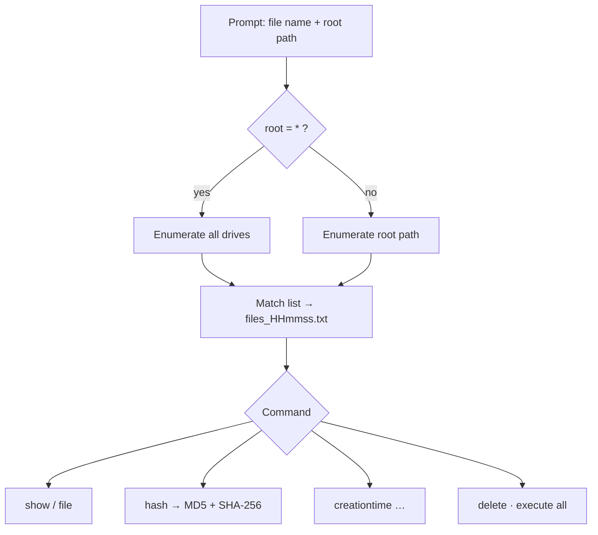

<div align="center">

# 📂 FileWalker

**Find files across every drive, then act on the results — hash, retime, launch or delete them in bulk from one console.**

[](https://github.com/mr-aybee/file-walker/actions/workflows/ci.yml)


[](LICENSE)

</div>

---

## Overview

FileWalker is a Windows command-line tool for locating files by name or wildcard, either under one folder or across all logical drives, and then running batch operations on the matches. Every search result set is saved to a timestamped text file, so it can be reviewed, reused or fed back in for deletion.

## Features

- 🔎 **Wildcard search** (`*.log`, `report?.docx`) under a path or across all drives (`*`)
- 📝 **Result snapshots** written to `files_HHmmss.txt`
- 🔐 **Hashing** — MD5 and SHA-256 for every match (via PowerShell runspace)
- 🕒 **Timestamp control** — set creation time to now, a specific date, or the modified time
- 🗑️ **Bulk delete** with confirmation, or delete from a prepared list file
- ▶️ **Bulk launch** of every matching file

## How it works



## Tech stack

| Layer | Technology |
| --- | --- |
| Runtime | C# · .NET Framework 4.8 console app |
| Hashing | `System.Management.Automation` PowerShell runspace |
| Filesystem | Recursive, access-error-tolerant enumeration |

## Getting started

### Prerequisites

- Windows with .NET Framework 4.8
- Visual Studio 2019+ or Build Tools with MSBuild

### Build

```shell
git clone https://github.com/mr-aybee/file-walker.git
cd file-walker
nuget restore FileWalkerSolution.sln
msbuild FileWalkerSolution.sln /p:Configuration=Release
```

The executable is written to `FileWalker/bin/Release/FileWalker.exe`.

## Usage

```text
> FileWalker.exe
Please Enter File Name:   *.tmp
Please root Path:         D:\Projects
Files Found: 42
>>> hash
```

| Command | Action |
| --- | --- |
| `n` / `no` | Start a new search |
| `show` | Print every matching path |
| `file` | Open the saved result list |
| `hash` | Compute MD5 + SHA-256 (also appended to `Hash.txt` beside each file) |
| `creationtime now` | Set creation/modified time to now |
| `creationtime dt:<yyyy-mm-dd hh:mm:ss>` | Set a specific timestamp |
| `creationtime modifiedtime` | Copy modified time into creation time |
| `delete` | Delete all matches (asks for confirmation) |
| `execute all` | Launch every matching file |

Delete from a prepared list (one full path per line):

```shell
FileWalker.exe C:\path\to\filelist.txt
```

> ⚠️ `delete` and `execute all` act on every match. Review the list with `show` first.

## Project structure

```text
file-walker/
├── FileWalkerSolution.sln
└── FileWalker/
    ├── Program.cs        # Prompt loop, search and batch commands
    └── FileSkeleton.cs   # Drive/folder tree model
```

## Development

- Open `FileWalkerSolution.sln` in Visual Studio; restore NuGet packages on first build.
- CI builds the solution with MSBuild on Windows for every push and pull request.

## Contributing

Contributions are welcome. Read [CONTRIBUTING.md](CONTRIBUTING.md) for the branch, build and pull-request workflow. Please report security issues privately through [GitHub security advisories](https://github.com/mr-aybee/file-walker/security/advisories/new), not public issues.

## Code of Conduct

This project follows the [Contributor Covenant](CODE_OF_CONDUCT.md). By participating you agree to uphold it.

## License

Released under the [MIT License](LICENSE). © 2026 Abdullah Shahid.
